<div dir="rtl" lang="ar">

<p align="center">
  
</p>

# closeAll

تطبيق صغير لشريط القوائم في macOS. ضغطة واحدة تعمل إغلاق إجباري (Force Quit) لكل برامج الـ Dock العادية.

الأيقونة فوق شكل نوافذ صغيرة. اضغطها، راجع القائمة، ثم اضغط **Force Quit**. البرامج المحددة تنقفل بالقوة، والتغييرات غير المحفوظة تضيع.

بجانب كل اسم أيقونة البرنامج نفسه. شيّل الصح عن أي برنامج بدك تبقّيه، والاختيار بينحفظ.

صورة المستودع هي [`docs/logo-512.png`](docs/logo-512.png) بقياس 512×512. ارفعها كصورة اجتماعية للمستودع من الإعدادات.

## شو بينقفل

كل تطبيق عادي يظهر في الـ Dock، بما فيه المتصفح والمحرر وCursor، إلا إذا شلت الصح عنه.

وكمان برامج الخلفية اللي بتعلّمها بقسم **Background apps**. هاد القسم فيه برامج شريط القوائم اللي ثبّتها بمجلد `/Applications` أو `~/Applications`، متل برنامج الحافظة أو الـ VPN. بتبدأ بدون صح، فما بينقفل منها شي إلا إذا علّمته، والاختيار بينحفظ.

closeAll بيتأكد إنو كل برنامج سكّر فعلاً. إذا ضل شغال أو رجع فتح، بيبعتله إغلاق قاسي (SIGKILL) لحد تلات مرات، واللي ما قدر يسكّره بيكتب اسمه بالأحمر.

## شو بيضل مفتوح

- **Finder**، حتى تضل الشاشة والجلسة.
- **closeAll** نفسه، حتى يضل الزر موجود.
- الـ Dock وControl Center وعمليات الجلسة.
- برامج الخلفية اللي ما علّمتها. برامج Apple بشريط القوائم، والعمليات المساعدة اللي جوّا برنامج تاني (متل Slack Helper)، والعمليات اللي ما إلها نافذة، ما بتظهر أصلاً.
- أي برنامج شلت الصح عنه.

## التثبيت

```bash
git clone git@github.com:Alhamou/closeAll.git
cd closeAll
make app
open build/closeAll.app
```

انسخ `build/closeAll.app` إلى `/Applications` إذا بدك يبقى. التطبيق ما بيظهر في الـ Dock.

البناء موقّع محليًا وغير موثّق عند Apple. إذا macOS منع أول تشغيل، اضغط كليك يمين على `closeAll.app` واختر **Open**.

## الرخصة

[MIT](LICENSE)

التفاصيل بالإنجليزية في [README.md](README.md).

</div>
