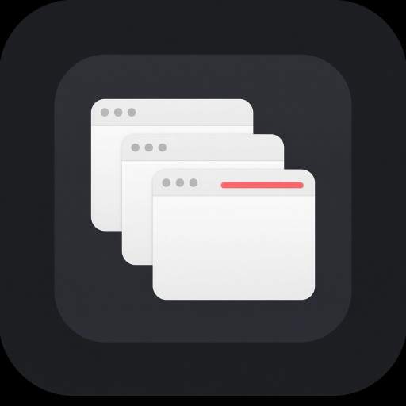

<p align="center">
  
</p>

<h1 align="center">closeAll</h1>

<p align="center">
  Force-quit every normal Dock app from one menu-bar button on macOS.
</p>

<p align="center">
  <a href="LICENSE">MIT</a>
  ·
  <a href="README.ar.md">العربية</a>
  ·
  <a href="CONTRIBUTING.md">Contributing</a>
  ·
  <a href="SECURITY.md">Security</a>
</p>

The icon in the menu bar is a small stack of windows. Click it, review the list, then press **Force Quit**. Checked apps are closed with Force Quit. Unsaved work in those apps is lost.

Each row shows the app’s own icon, so you can recognize it before it closes. Uncheck an app to keep it. That choice is remembered.


The picture above is the repository image: [`docs/icon-512.png`](docs/icon-512.png), 512×512 pixels. Use that file as the GitHub social preview (repository Settings → General → Social preview).

## What closes

- Every app macOS treats as a normal application. Those are the apps you would otherwise right-click in the Dock and choose Quit.
- Editors, browsers, and chat apps are included. Cursor is included until you uncheck it.

## What stays open

- **Finder**, so the desktop stays up.
- **closeAll** itself, so the button is still there.
- The Dock, Control Center, WindowServer, and the other processes that keep the login session alive.
- Menu-bar-only helpers. They are not Dock apps. Quitting the parent app usually takes its helpers with it.
- Any app you uncheck.

## Requirements

- macOS 14 or later
- Apple silicon for the app built by `make app` on an Apple silicon Mac

closeAll is not sandboxed. The App Sandbox would block it from quitting other applications. It does not use the network, and it does not collect analytics. The keep-list is stored only in your local preferences.

## Install

```bash
git clone git@github.com:Alhamou/closeAll.git
cd closeAll
make app
open build/closeAll.app
```

Copy `build/closeAll.app` to `/Applications` if you want it to stay installed. The app does not show a Dock icon.

The build is signed ad hoc so it can launch on your Mac. It is not notarized. If macOS blocks the first open, right-click `closeAll.app`, choose **Open**, then confirm.

To quit closeAll, open the panel and choose **Quit closeAll**.

To open it at login, add `closeAll.app` in System Settings → General → Login Items.

## Use

1. Click the stack-of-windows icon at the top of the screen.
2. Leave a check on every app that should close. Remove the check to keep one.
3. Press **Force Quit**.

Force Quit does not ask those apps to save. Close anything with unsaved work first, or uncheck it.

## Build and test

```bash
swift test
make check
```

`make check` runs the unit tests, then prints the live quit plan without closing anything. The check fails if that plan includes Finder, this process, or another session process.

```bash
swift run closeAll -- --dry-run
swift run closeAll -- --demo-window
swift run closeAll -- --render-preview /tmp/closeall-panel.png
```

`--dry-run` prints the quit plan as JSON and exits. `--demo-window` opens the same panel in a normal window. `--render-preview` writes a PNG of that panel and exits. None of these close other apps.

## Project layout

| Path | Purpose |
| --- | --- |
| `Sources/closeAllCore` | Pure quit rules. No AppKit. Covered by unit tests. |
| `Sources/closeAll` | Menu-bar app. |
| `Tests/closeAllCoreTests` | Unit tests. |
| `docs/icon-512.png` | Repository image, 512×512. |
| `Resources/AppIcon.icns` | Icon inside the app bundle. |
| `Scripts/package-app.sh` | Builds `build/closeAll.app`. |
| `Scripts/verify-live-plan.py` | Fails if a dry-run would quit Finder or this process. |

## Contributing

See [CONTRIBUTING.md](CONTRIBUTING.md). This project follows the [Code of Conduct](CODE_OF_CONDUCT.md). To report a security issue, see [SECURITY.md](SECURITY.md).

## License

[MIT](LICENSE) © 2026 closeAll contributors
